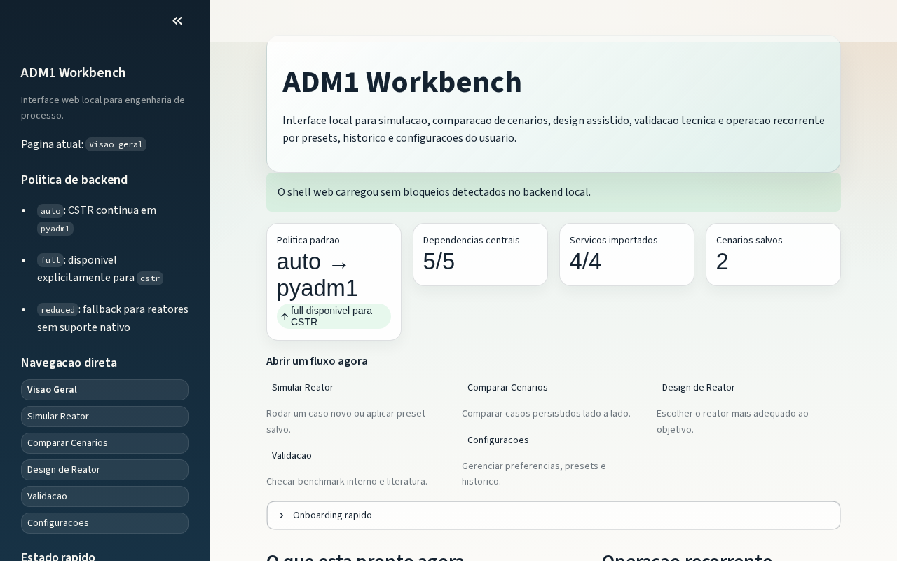
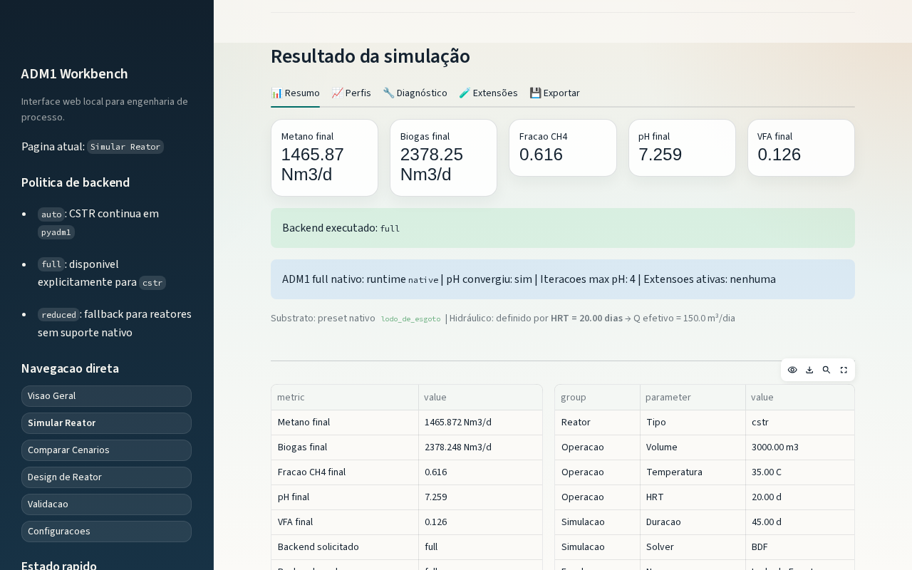
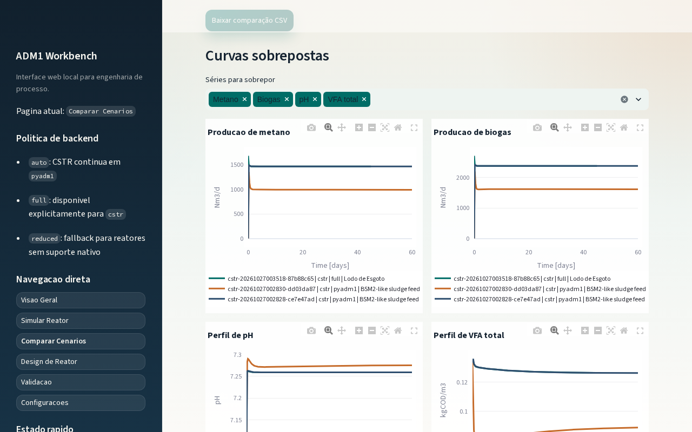
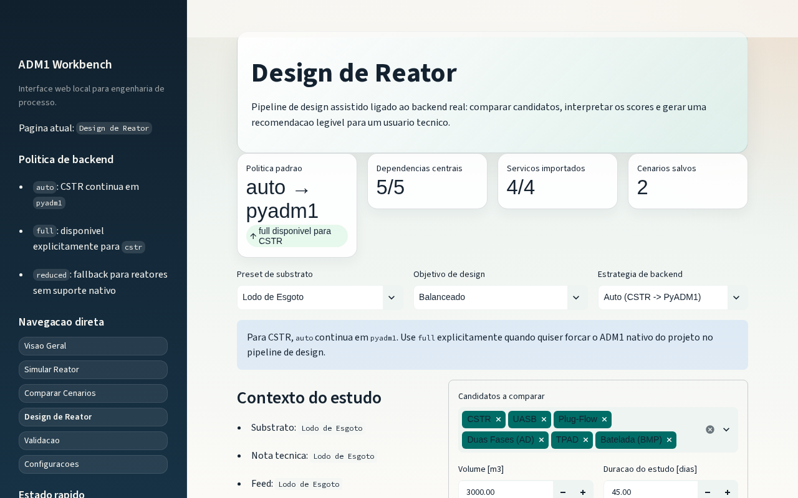

# ADM1 Workbench

> Plataforma local em Python para simular, comparar, validar e apoiar o design de reatores de digestão anaeróbia usando o **Anaerobic Digestion Model No. 1 (IWA ADM1)**.


---

## Desenvolvido com IA

Este projeto foi construído com participação ativa de modelos de linguagem ao longo de todo o ciclo de desenvolvimento — não apenas como assistente de código, mas como parceiro de arquitetura, revisão técnica e documentação.

| Modelo | Uso principal |
|---|---|
| **Claude (Anthropic)** | Arquitetura, revisão de código, documentação, validações técnicas |
| **Codex (OpenAI)** | Geração e refatoração de código |
| **GitHub Copilot** | Autocompletar e iterações rápidas no editor |
| **Gemini (Google)** | Revisão e contraponto técnico, busca na internet |

As decisões de arquitetura, curadoria de escopo e responsabilidade de publicação permanecem sob revisão humana.

---

## Visão Geral

ADM1 Workbench combina um motor numérico ADM1, uma interface web Streamlit e ferramentas CLI em um único repositório autocontido:

| Componente | Descrição |
|---|---|
| `simulator/` | Motor ADM1, backends numéricos, validações, design e servidor MCP |
| `webapp/` | Interface Streamlit com 5 páginas funcionais |
| `vendor/PyADM1/` | Submódulo PyADM1 vendorizado (backend de alta fidelidade) |
| `scripts/` | Automações PowerShell para setup, execução e verificação |

---

## Funcionalidades

- **Simulação** — execute estudos ADM1 com persistência opcional de cenários
- **Comparação** — compare cenários salvos com deltas de KPIs e sobreposição de séries temporais
- **Design assistido** — ranqueie tipos de reator conforme objetivo técnico (metano, estabilidade, etc.)
- **Validação** — benchmark interno, caso BSM2 e checagem OpenModelica
- **Backends** — `pyadm1` e `full` (referência) e `reduced` (rápido e exploratório, para tendências, não dimensionamento). O reduzido não consome nitrogênio no crescimento, usa inibição de pH gaussiana e estequiometria simplificada
- **Servidor MCP** — integração com agentes e automações externas

---

## Início Rápido

### 1. Clone com submódulos

```bash
git clone --recurse-submodules <repo-url>
cd ADM1
```

Se o clone já foi feito sem submódulos:

```bash
git submodule update --init --recursive
```

### 2. Crie o ambiente e instale dependências

Os scripts de `scripts/` existem em duas versões: `.ps1` (Windows PowerShell) e `.sh` (Linux e macOS).
O script de setup também inicializa o submódulo `vendor/PyADM1`.

**Windows (PowerShell):**

```powershell
.\scripts\setup_local.ps1
```

**Linux / macOS (Bash):**

```bash
./scripts/setup_local.sh                        # usa python, depois python3
./scripts/setup_local.sh --python-exe python3.12  # escolhe o interpretador
```

Ou manualmente:

```powershell
# Windows
python -m venv .venv
.\.venv\Scripts\activate
pip install -r requirements.txt
```

```bash
# Linux / macOS
python3 -m venv .venv
source .venv/bin/activate
pip install -r requirements.txt
```

### 3. Verifique o ambiente

```powershell
.\scripts\check_env.ps1     # Windows
```

```bash
./scripts/check_env.sh        # Linux / macOS
```

### 4. Inicie a interface web

```powershell
.\scripts\run_webapp.ps1    # Windows
```

```bash
./scripts/run_webapp.sh       # Linux / macOS (aceita --port e --headless)
```

Ou diretamente, com o ambiente ativado: `streamlit run webapp/app.py`.

Acesse em: **http://localhost:8501**

---

## Screenshots

### Visão geral — Home



### Simular Reator — configuração do caso



### Comparar Cenários — curvas sobrepostas



### Design de Reator — pipeline assistido



---

## Interface Web

Cinco páginas acessíveis pelo sidebar:

| Página | Função |
|---|---|
| **Simular Reator** | Monta e executa estudos ADM1; salva presets e cenários |
| **Comparar Cenários** | Compara execuções persistidas com deltas KPI e séries sobrepostas |
| **Design de Reator** | Ranqueia reatores candidatos conforme objetivo técnico |
| **Validação** | Executa e lê validações locais (benchmark interno, BSM2, OpenModelica) |
| **Configurações** | Gerencia preferências, presets e histórico local |

---

## Backends de Simulação

| Backend | Fidelidade | Velocidade | Indicado para |
|---|---|---|---|
| `pyadm1` | Alta — ADM1 IWA completo | Mais lento | Estudos CSTR com rigor técnico |
| `reduced` | Modelo 11 estados | Mais rápido | Exploração, fallback, protótipos |
| `auto` | — | — | Seleção automática com registro explícito de fallback |

O backend `pyadm1` está vendorizado em `vendor/PyADM1/` como submódulo Git.

---

## Uso Via CLI

```bash
# Benchmark local
python -m simulator.benchmark

# Validação
python -m simulator.validation

# Design de reator
python -m simulator.design_pipeline --substrate "Lodo de Esgoto" --goal balanced --backend auto

# Servidor MCP
python simulator/mcp_server.py
```

---

## Testes

```bash
# Suíte principal
python -m pytest simulator/tests -q

# Testes do webapp
python -m pytest webapp/testing -q

# Testes focados
python -m pytest simulator/tests/test_simulator.py -q
python -m pytest simulator/tests/test_literature_validation.py -q
python -m pytest simulator/tests/test_full_model_phase6.py -q
```

---

## Estrutura do Projeto

```text
ADM1/
├── simulator/              # motor ADM1, backends, validações, design e MCP
│   ├── core/               # modelos Pydantic, defaults, cinética e adapter PyADM1
│   ├── full_model/         # modelo full nativo, extensões e governança
│   ├── reactor_models/     # estratégias de reator (CSTR, UASB, plug-flow)
│   └── tests/              # suíte pytest do simulador
├── webapp/                 # interface Streamlit
│   ├── pages/              # páginas numeradas da interface
│   ├── services/           # serviços consumidos pela UI
│   └── testing/            # testes de suporte do webapp
├── scripts/                # automações PowerShell (.ps1) e Bash (.sh)
├── vendor/PyADM1/          # submódulo PyADM1
├── requirements.txt
└── pyproject.toml
```

Diretórios gerados localmente (não versionados): `simulator/runs/`, `simulator/.pyadm1_runtime/`, `webapp/user_data/`, `dist/`.

---

## Requisitos

- **Python 3.11+**
- **Git** com suporte a submódulos
- **Windows PowerShell** ou **Bash** (para os scripts em `scripts/`)
- **OpenModelica** — opcional; necessário apenas para validações cruzadas específicas

---

## Artefatos Locais

Fluxos do workbench podem gerar arquivos locais (todos ignorados pelo `.gitignore`):

| Diretório | Conteúdo |
|---|---|
| `simulator/runs/` | Cenários persistidos |
| `simulator/benchmarks/` | Resultados de benchmark |
| `simulator/validation_runs/` | Validações internas |
| `simulator/literature_validation_runs/` | Validações BSM2 |
| `webapp/user_data/` | Preferências e presets da UI |

---

## Desenvolvimento

Stack principal: Python 3.11+, Pydantic v2, NumPy, SciPy, Pandas, Plotly, Streamlit.

Não há formatter ou linter obrigatório configurado — siga o estilo local: type hints, funções pequenas, testes focados.

- **Ao alterar cinética, estequiometria ou backends** → atualize ou adicione testes em `simulator/tests/`
- **Ao alterar a UI** → valide manualmente no Streamlit e rode `webapp/testing` quando aplicável

---

## Licença

Copyright 2026 Rene Pereira Milare

Distribuído sob a **Apache License 2.0** — veja o arquivo [`LICENSE`](LICENSE) para os termos completos.

### Dependência vendorizada — PyADM1

O subdiretório `vendor/PyADM1/` é um submódulo Git apontando para o projeto [PyADM1](https://github.com/CaptainFest/PyADM1), licenciado sob **MIT License** (Copyright 2021 Peyman Sadrimajd). A atribuição original deve ser mantida ao redistribuir ou publicar bundles derivados.
